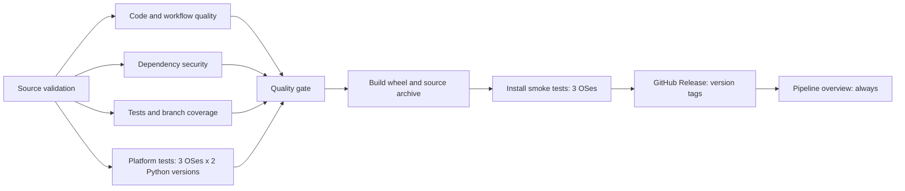

# Team15_SE_Project
A desktop Snake game built with Python and Pygame, alongside its SE documents.

## CI/CD pipeline

[](https://github.com/akshatha2005/Team15_SE_Project/actions/workflows/ci.yml)

Open **Actions → Snake Game CI/CD → a run** to see the live job dependency graph.
Each job writes its result and a description to the run's **Summary** page.
The final overview lists every stage, including failures and skipped jobs.



| Stage | Summary and evidence |
| --- | --- |
| Source validation | Compile the application, tests and CI scripts; validate package metadata and release tags. |
| Code and workflow quality | Ruff correctness checks and actionlint validation of the workflow. |
| Dependency security | pip-audit rejects known vulnerabilities in resolved application/test dependencies; JSON audit artifact. |
| Tests and branch coverage | Full pytest suite, JUnit results and HTML/XML coverage; at least 85% combined statement/branch coverage. |
| Platform tests | Full suite on Windows, macOS and Linux with Python 3.12 and 3.13; six separate result artifacts. |
| Quality gate | Every validation and test branch must succeed before packaging. |
| Build distributions | Validate a Python wheel and source archive with Twine; upload both with SHA-256 checksums. |
| Installed game checks | Verify checksums and exercise the installed module and console entry point outside the source tree on each OS. |
| GitHub Release | On a matching `v*` tag whose commit belongs to `main`, publish the tested distributions and checksums. |
| Pipeline overview | Always report the result of every stage; fail if a required stage failed or was skipped. |

Pull requests, pushes to `main`, version tags and manual dispatches run the pipeline.
Release publishing is skipped for pull requests, ordinary branch pushes and manual runs.
Test/audit reports are retained for 14 days; package artifacts for 30 days.
Headless checks use SDL dummy drivers; native desktop acceptance remains a manual check.

To run the main checks locally:

```sh
python -m pip install -r requirements-ci.txt
python -m ruff check snake_game tests .github/scripts main.py
python -m pytest --cov=snake_game --cov-branch --cov-fail-under=85
python -m build
python -m twine check --strict dist/*
```

For a release, merge the desired version into `main`, set `project.version` in
`pyproject.toml`, and push the matching tag (for example `v1.0.0`). All checks must
pass before the release job publishes. Download the wheel from the run artifacts
or GitHub Releases, install it with `python -m pip install <wheel-file>`, then run
`team15-snake` or `python -m snake_game`. Python and Pygame are required; the wheel
is a Python package rather than a standalone desktop executable.

## Sprint milestones

Work is tracked in three [GitHub milestones](https://github.com/akshatha2005/Team15_SE_Project/milestones):

1. **Sprint 1 - Core Gameplay:** menu, board, movement, input, food, scoring and collisions.
2. **Sprint 2 - Persistence and Advanced Gameplay:** high scores, pause/resume, restart, difficulty and the game loop.
3. **Sprint 3 - Quality, Security and Delivery:** stability, platform checks, security and CI/CD.

See [the sprint plan](docs/sprints.md) for issue assignments and acceptance criteria.

## Team Members

| Name                | SRN            |
|---------------------|----------------|
| Akshatha P          | PES2UG24CS048  |
| Aditya Shrivastav   | PES2UG24CS036  |
| Ananya Ratnaparkhi  | PES2UG24CS058  |
| Alakh Gupta         | PES2UG24CS051  |


## Movement speed (SNK-F-018)

The initial movement interval is 150 ms. At scores 50, 100, 150, 200,
and 250 it drops to 130, 110, 90, 70, and 50 ms respectively. The interval
stays at 50 ms above 250 points. These fixed defaults resolve the thresholds
left open in the design document; they live in `snake_game/difficulty.py`.
Resetting the engine resets the score and restores 150 ms. Rendering continues
to use the existing 60 FPS clock independently of movement speed.

## Run on Windows, macOS, or Linux (SNK-NF-004)

Use Python 3.12 or 3.13 and run these commands from the repository root.
No source changes are needed between desktop platforms.

Windows PowerShell:

```powershell
py -3.12 -m venv .venv
.\.venv\Scripts\python.exe -m pip install -r requirements.txt
.\.venv\Scripts\python.exe -m snake_game
```

macOS / Linux:

```sh
python3 -m venv .venv
.venv/bin/python -m pip install -r requirements.txt
.venv/bin/python -m snake_game
```

`python main.py` is also supported when using your environment's Python.
Use arrow keys or WASD to steer, P to pause/resume, and close the window to exit.
A normal desktop session with a display is required for interactive play.
This is the desktop build; browser delivery is outside this change.

### Platform validation

CI installs Pygame, compiles the sources, and runs the complete suite on Windows,
macOS, and Linux with Python 3.12 and 3.13. It uses SDL's dummy video/audio drivers
for deterministic headless checks. Launcher tests start a fresh process, render
frames, exercise direction and pause controls, and close the window cleanly.
These checks do not establish native window/input behavior or interactive performance.

For a manual acceptance pass on each OS: launch the game, check the visible board
and centred three-segment snake, steer with arrows/WASD, press P twice to verify
pause/resume, play to a wall or self collision, and close the window. Record the
OS, Python/Pygame versions, and observed result in the test execution log.
Windows and macOS results depend on their CI jobs and manual desktop checks;
local Linux headless results alone are not evidence of those platforms passing.
